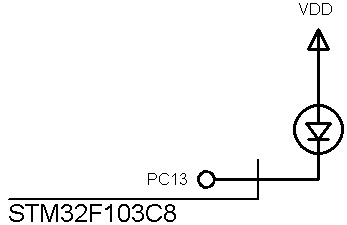

## RCC

### Simulate  
  

### Features
- **MCU:** STM32F103C8

### Folders and Files
- `BareMetal` (Exercises using CMSIS)
- `Simulate` (Simulation file)

Note: The simulation doesn't work for this exercise.    

### Useful Links
GitHub Profile:  
[GitHub.com/AliRezaJoodi](https://github.com/AliRezaJoodi)   
Download single folder or file from GitHub:  
[https://minhaskamal.github.io/DownGit/#/home](https://minhaskamal.github.io/DownGit/#/home)  